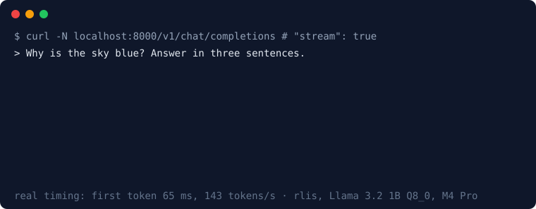
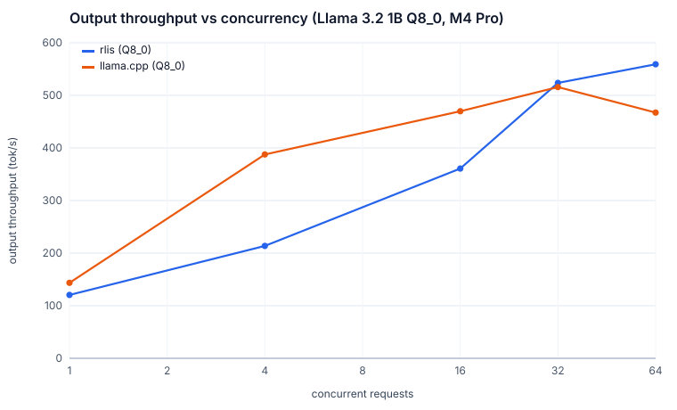
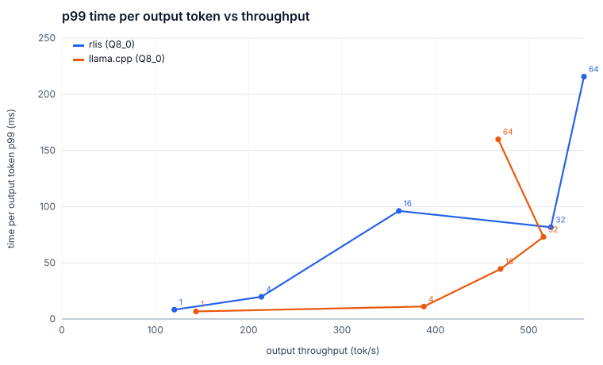
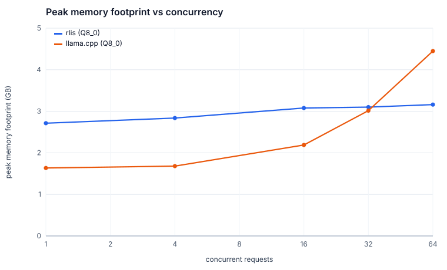
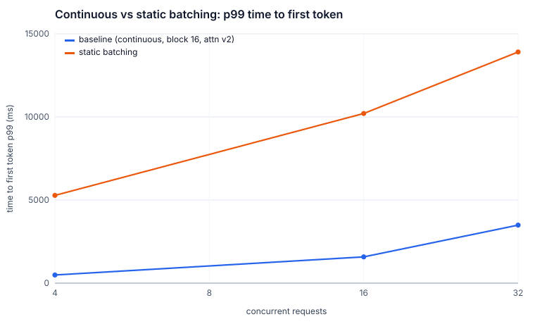
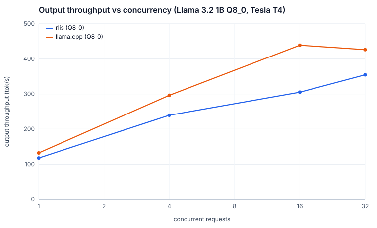

# rlis — a Rust LLM inference server for Apple Silicon

An LLM serving engine in Rust with continuous batching, a paged KV cache, custom Metal kernels
and an OpenAI-compatible streaming API. It runs Llama 3.2 1B on a MacBook's GPU inside a fixed
~3 GB memory budget, matches Hugging Face transformers token-for-token, and out-serves
llama.cpp's server at high concurrency.



## Quick start

```sh
make chat           # downloads the model (1.3 GB, into ./models), builds, chats in the terminal
```

Needs Rust (`rustup`) and an Apple Silicon Mac. `make teardown` removes everything the project
downloaded or built.

### Terminal chat

`make chat` opens a chat in the terminal. `make install` puts it on your PATH as `rlis` (a link
in `~/.cargo/bin` to this build), so from any directory `rlis` opens the chat and `rlis serve`,
`rlis generate` and `rlis perplexity` run the server binary. `make uninstall` removes the link.
Replies stream in with Markdown styling (headings, bold, code, lists) under a live status
line (prefill, then decoding with tokens and tok/s so far), and each one ends with its token
count, decode speed and time to first token. Each exchange is drawn as a card (your message,
then the reply, with its stats in the bottom edge), and the prompt card's top edge shows the
model, temperature and conversation length. Typing `/` opens a command menu. If no
server answers at `--url` (default `http://127.0.0.1:8000`), it starts `rlis serve` in the
background, warms it up so the first reply is fast, and stops it on exit; an already running
server is used as is. The conversation is kept across turns, and the oldest exchanges are
dropped when it outgrows the 2,048-token context.

| Command | |
|---|---|
| `/clear` | start a new conversation |
| `/retry` | regenerate the last reply |
| `/system <prompt>` | show or set the system prompt (`/system none` removes it) |
| `/temp <x>` | show or set the temperature (default 0.6, top-p 0.9) |
| `/help`, `/exit` | |

| Key | |
|---|---|
| enter | send |
| `\` then enter | new line (shift+enter and option+enter also work in terminals that send them) |
| esc | interrupt a reply (generation stops on the server too), or clear the input |
| ↑ ↓ | previous messages, or move through the `/` menu |
| tab | complete a command |
| ctrl-c twice, or ctrl-d on an empty line | quit |

Options: `--system`, `--temperature`, `--top-p`, `--max-tokens`, `--url`, `--no-start` (fail
instead of starting a server), and `rlis serve` flags after `--` for a server it starts, e.g.
`rlis -- --model models/Llama-3.2-1B-Instruct-Q4_K_M.gguf --kv-cache-gb 2`. A started
server logs to `target/release/rlis-chat-server.log`.

### Server and API

```sh
make serve          # serves on http://127.0.0.1:8000
```

```sh
curl http://127.0.0.1:8000/v1/chat/completions -H 'content-type: application/json' \
  -d '{"messages":[{"role":"user","content":"Why is the sky blue?"}]}'
```

With `"stream": true` (and `curl -N`) the reply arrives as server-sent events, one `data:` line
per token. Any OpenAI client works against `http://127.0.0.1:8000/v1`:

```python
from openai import OpenAI

client = OpenAI(base_url="http://127.0.0.1:8000/v1", api_key="unused")
stream = client.chat.completions.create(
    model="llama-3.2-1b-instruct",
    messages=[{"role": "user", "content": "Why is the sky blue?"}],
    stream=True,
)
for chunk in stream:
    if chunk.choices:
        print(chunk.choices[0].delta.content or "", end="", flush=True)
```

Endpoints: `POST /v1/chat/completions`, `POST /v1/completions`, `GET /v1/models`, `GET /health`,
`GET /metrics`. `target/release/rlis serve --help` lists the server's flags (model, KV pool size,
context length, host and port, scheduler).

## Benchmarks

Same model (Llama 3.2 1B Instruct, GGUF Q8_0), same 32,768-token f16 KV budget, same
2,048-token batch, prompt caching off on both, on an M4 Pro (20-core GPU, 24 GB, macOS 26.6).
256 fixed prompts cut from WikiText-2 with log-normal lengths (mean 295 input / 159 output
tokens), each generating exactly its target length. llama.cpp is build `b11936` with Metal,
flash attention and a unified KV cache.





| Concurrent requests | rlis tok/s | llama.cpp tok/s | rlis ITL p50 | llama.cpp ITL p50 | rlis peak memory | llama.cpp peak memory |
|---|---|---|---|---|---|---|
| 1 | 120 | **144** | 7.8 ms | **6.4 ms** | 2.71 GB | 1.64 GB |
| 4 | 214 | **388** | 16.0 ms | **7.8 ms** | 2.84 GB | 1.68 GB |
| 16 | 361 | **470** | 24.5 ms | **17.8 ms** | 3.08 GB | 2.19 GB |
| 32 | **524** | 516 | **30.2 ms** | 36.1 ms | 3.10 GB | 3.02 GB |
| 64 | **559** | 467 | **52.4 ms** | 83.9 ms | 3.16 GB | 4.45 GB |

llama.cpp is faster up to 16 concurrent requests: its hand-tuned quantized kernels prefill
~20% faster and decode small batches faster than candle's (the profile is in
[DESIGN.md](DESIGN.md#where-the-time-goes)). rlis pulls ahead at 32–64, where scheduling
dominates: +20% throughput and 38% lower median inter-token latency at 64. Its KV pool is
reserved up front, so memory stays flat at ~3.1 GB while llama.cpp's grows to 4.5 GB. Full
percentiles and provenance: [`results/mac/tables.md`](results/mac/tables.md).

Reproduce: `make llama-cpp bench-mac bench-charts`.

### Ablations

One change at a time against the default configuration (concurrency 4 / 16 / 32):

| Change | Throughput (tok/s) | p99 time to first token |
|---|---|---|
| **default** (continuous batching, 16-token blocks, paged-attention kernel, GEMV) | 214 / 373 / 540 | 0.49 / 1.6 / 3.5 s |
| static batching | 158 / 244 / 374 | 5.3 / 10.2 / 13.9 s |
| attention v1 (gather blocks, then attention) | 132 / 156 / 186 | 0.45 / 1.5 / 3.4 s |
| no small-batch GEMV | 157 / 363 / 533 | 0.49 / 1.6 / 3.5 s |
| block size 8 / 32 | within 1% of default | within noise |
| shared system prompt, prefix caching off | 192 / 305 / 417 | 0.74 / 2.7 / 5.5 s |
| shared system prompt, prefix caching **on** | 204 / 372 / **634** | 0.53 / 0.50 / **0.53 s** |



### Quantization

| Format | WikiText-2 perplexity | Top-1 agreement with f32 reference | Decode, 1 stream |
|---|---|---|---|
| f16 | 14.0009 ± 0.104 | exact | 83 tok/s |
| **Q8_0** (default) | 14.0035 ± 0.104 | 99.38% | 145 tok/s |
| Q4_K_M | 14.4563 ± 0.108 | 94.45% | 196 tok/s |

### CUDA (free Kaggle T4)

The same engine code built with `--features cuda`, run in one free Kaggle session on a Tesla T4
(driver 580.178, CUDA 12.8, 4 vCPUs) at commit `d763c10`. The reference parity tests passed on
the T4 first (f32 token-for-token, including the paged batch of 32; f16 within its near-tie
rule), then the same sweep ran against llama.cpp `b11936` built with CUDA, both on one GPU, with
the same flags as on the Mac. Concurrency stops at 32: Kaggle's free GPU time is 6 hours a week.



| Concurrent requests | rlis tok/s | llama.cpp tok/s | rlis ITL p50 | llama.cpp ITL p50 | rlis p99 TTFT | llama.cpp p99 TTFT | rlis peak memory | llama.cpp peak memory |
|---|---|---|---|---|---|---|---|---|
| 1 | 118 | **132** | 8.2 ms | **7.2 ms** | **106 ms** | 266 ms | **3.54 GB** | 3.76 GB |
| 4 | 239 | **296** | 15.0 ms | **10.7 ms** | 273 ms | **214 ms** | **3.54 GB** | 3.80 GB |
| 16 | 305 | **439** | 39.4 ms | **20.8 ms** | **0.82 s** | 1.07 s | **3.69 GB** | 4.30 GB |
| 32 | 355 | **426** | 73.3 ms | **43.7 ms** | **2.0 s** | 4.4 s | **3.70 GB** | 5.06 GB |

Single-stream decode reaches 89% of llama.cpp's (the spec's CUDA target is 60%), but unlike on
the Mac llama.cpp stays ahead at every concurrency. rlis on CUDA runs without its four Metal
kernels (paged decode attention, small-batch GEMV, GPU sampling, fused prefill attention) and
falls back to gather-then-attend, candle's generic matmuls and host-side sampling; on the Mac
the gather path alone cost 2.9× at 32 requests. A CUDA port of the paged-attention kernel is the
spec's first stretch goal. Memory on Linux is process RSS plus GPU memory in use: rlis's pool is
reserved up front (3.5–3.7 GB), llama.cpp's grows to 5.1 GB. Details, and what it took to get
a clean run: [DESIGN.md](DESIGN.md#cuda-run). Results and provenance:
[`results/cuda/`](results/cuda/tables.md).

Reproduce: `make bench-cuda` (needs a Kaggle account with phone verification; it pushes the
session pinned to `HEAD`, waits, and downloads the results).

### Targets

The spec's starting targets against what was measured on the Mac (and the T4 for the CUDA row):

| Target | Result | |
|---|---|---|
| Single-stream decode ≥ 70% of llama.cpp | 83% (120 vs 144 tok/s) | met |
| Throughput at 32 concurrent requests ≥ 4× single-stream | 4.4× (524 vs 120 tok/s) | met |
| p99 time to first token at moderate load within 2× of unloaded | 2.7× at 4 concurrent, 9.4× at 16 (llama.cpp: 2.1×, 6.8×) | missed |
| KV utilization under load > 90% with no out-of-memory errors | pool reaches 100%; 18 preemptions, 0 errors (64-request stress test) | met |
| Peak footprint, default run ≤ 3.5 GB | 3.26 GB in the worst case | met |
| Memory flat over a 1-hour soak | 10-minute averages within 2,589–2,645 MB (+2.9% early to late) | met |
| Single-stream decode on CUDA ≥ 60% of llama.cpp | 89% (118 vs 132 tok/s, Tesla T4) | met |

The time-to-first-token miss comes from the workload: every benchmark client sends a ~300-token
prompt the moment its last request finishes, so a new prompt queues behind other prompts'
prefill chunks. Shared prefixes remove most of it (with prefix caching, p99 stays at ~0.5 s
from 4 to 32 concurrent requests, see Ablations); unique prompts need faster prefill.

## What's inside

- **Continuous batching** with chunked prefill, FCFS admission, and preemption by recompute
  (on unified memory, swapping to "host" frees nothing).
- **Paged KV cache**: fixed pool from `--kv-cache-gb`, 16-token blocks, refcounts with
  copy-on-write, and automatic prefix caching with LRU eviction.
- **Metal kernels**: paged decode attention that reads block tables directly, a small-batch
  Q8_0 GEMV, and GPU sampling (Gumbel-max with per-request counter-based noise).
- **Correctness first**: token-for-token parity with Hugging Face transformers (single and in a
  paged batch of 32), property tests for the allocator, a scheduler simulator, fuzzing of the
  request parser and stop strings, and a one-hour soak (13,018 requests with random client
  hang-ups, 0 errors, every KV block returned, memory flat within 3%).
- **Terminal client** (`rlis-chat`): a dependency-light chat UI over the same API, with a
  redrawn-in-place prompt box, streaming Markdown rendering and interrupt-by-disconnect.
- **Observability**: Prometheus `/metrics` (TTFT, ITL, throughput, queue, batch, preemptions,
  KV utilization, prefix-cache hits, memory footprint) and opt-in per-stage GPU timing
  (`RLIS_PROFILE=1`).

How it works and why: [DESIGN.md](DESIGN.md). The hardest bug:
[The 0.6 GB that wasn't in the pool](docs/blog-the-memory-that-wasnt-in-the-pool.md).

## Memory and disk

| | Measured |
|---|---|
| Default run (Q8_0, 1 GiB KV pool), benchmark load | 2.7–3.2 GB peak footprint |
| Default run, 64 long requests overfilling the pool | 3.26 GB peak footprint |
| Upper-bound run (3B Q4_K_M, 2 GiB pool) | not measured yet; the spec's budget estimate is ~5 GB |
| Model files (`make models` / `make models-all`) | 1.3 GB / 4.6 GB |
| Rust build (`./target`, release + debug, with and without Metal) | 13 GB |
| llama.cpp build (`./third_party`) | 0.36 GB |

`make teardown` stops project processes and deletes `models/`, `target/`, `third_party/` and
any virtualenv, leaving only code and results. Checked on a fresh clone with the models
downloaded, a release build and a running server: afterwards no project process was left and
the folder went from 2.3 GB to 3.7 MB. Outside the folder only the Rust toolchain remains
(`rustup self uninstall` removes it).

## Development

```sh
make test               # CPU tests (what CI runs)
make test-metal         # GPU kernel tests
make models-all parity  # parity against transformers (reference fixtures are committed)
make lint               # fmt + clippy, with and without Metal
make soak               # one hour at concurrency 32 with random client hang-ups
make bench-cuda         # parity + sweep on a free Kaggle T4 (results/cuda/)
```
