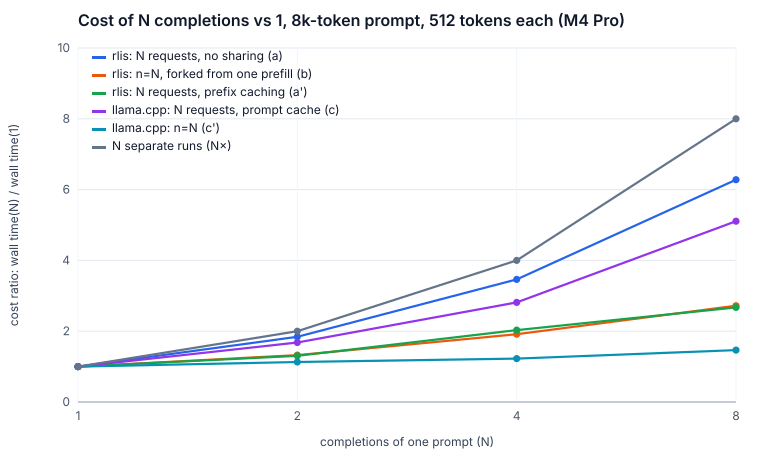
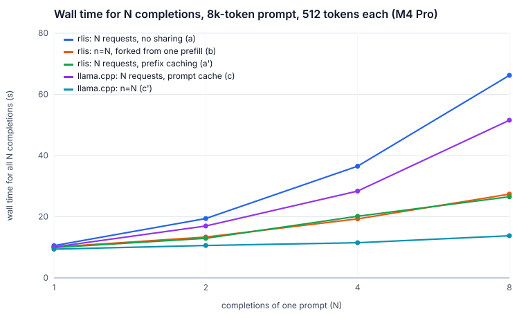
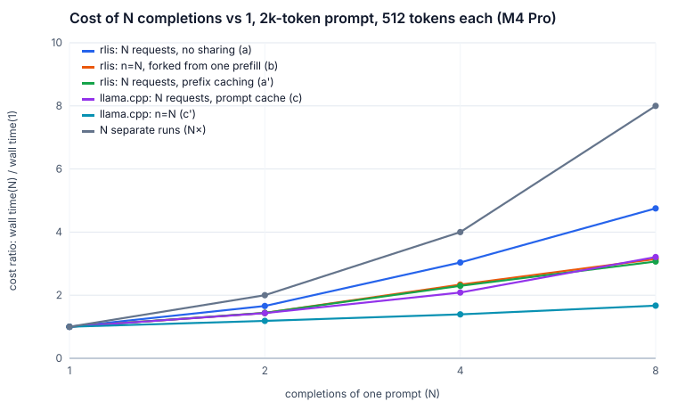
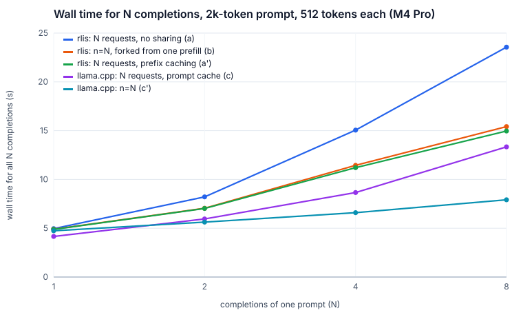

# What do N attempts cost? (`rlis fix` feasibility)

`rlis fix --n 8` only makes sense if 8 attempts at a patch cost far less than 8 separate
requests. The plan is for all N attempts to share one prefill of the prompt and decode together
in one batch. This page measures that on the Mac: if 8 attempts cost about 2–3× one attempt,
the idea holds; if it's close to 8×, it doesn't.

**Answer: it holds.** On rlis, 8 attempts forked from one prefill cost **1.83×** one attempt
with an 8k-token prompt and **2.32×** with a 2k prompt. Without sharing, the same work costs
3.47× and 3.11×, and llama.cpp's server with N separate requests costs 5.11× and 3.21×. The
catch is absolute speed, not the ratio. llama.cpp's own `n=8` path is 3.1× faster than rlis at
8k (13.8 s vs 42.7 s), because rlis decodes slowly against long contexts (see
[Where the time goes](#where-the-time-goes)).

## Setup

- **Hardware and model:** M4 Pro (20-core GPU, 24 GB), Llama 3.2 1B Instruct Q8_0, f16 KV
  cache.
- **Workload:** each run makes N completions of one prompt, of 2k or 8k tokens, with 512
  tokens each (`ignore_eos`), temperature 0.7, and one seed per completion. Every run starts
  with a unique tag and corpus slice (WikiText-2), so no run is helped by an earlier run's
  cache. Each cell is the median of 3 repetitions, and the repetitions interleave the N values.
- **Same budget for both servers:** 73,728 KV tokens (2.25 GiB), enough for 8 unshared 8k
  prompts plus their outputs, so rlis never preempts. Both servers get 2,048 tokens per step.
  llama.cpp runs 8 slots over a unified KV buffer, with flash attention and prompt cache on.
  Its host-RAM prompt store is capped at 1 GiB (`-cram 1024`); the default of 8 GiB would
  break the memory budget.
- **Wall time** runs from the first request sent to the last completion finished.
  **Cost ratio** is wall(N) / wall(1) for the same series and prompt length.
- **KV blocks in use** is the peak of rlis's `/health` `kv_blocks_used`, sampled every 25 ms.
  llama.cpp doesn't report KV cells in use.

| Series | What it is |
|---|---|
| (a) rlis: N requests, no sharing | N concurrent `n=1` requests, prefix caching off |
| (b) rlis: n=N, forked | one request with `n=N`: the prompt is prefilled once, then N sequences fork off it |
| (a′) rlis: N requests, prefix caching | (a) with prefix caching on (the server default) |
| (c) llama.cpp: N requests, prompt cache | N concurrent `n=1` requests |
| (c′) llama.cpp: n=N | one request with `n=N` (llama.cpp shares the prompt across its children) |

Run it with `make bench-fork`, then `make bench-charts`. Raw results are in
`results/mac/fork-*.json`.

## Results

Cost ratio at N=8 (median wall time in parentheses):

| Series | 2k prompt | 8k prompt |
|---|---|---|
| (a) rlis, N requests, no sharing | 3.11× (26.1 s) | 3.47× (79.1 s) |
| **(b) rlis, n=N, forked** | **2.32× (20.7 s)** | **1.83× (42.7 s)** |
| (a′) rlis, N requests, prefix caching | 2.17× (18.0 s) | 1.91× (43.2 s) |
| (c) llama.cpp, N requests, prompt cache | 3.21× (13.3 s) | 5.11× (51.6 s) |
| (c′) llama.cpp, n=N | 1.67× (7.9 s) | 1.47× (13.8 s) |

Full table (medians of 3 runs; footprint and KV blocks are the max over the 3):

| configuration | prompt | N | wall (s) | cost ratio | mean TTFT (s) | output tok/s | peak footprint | peak KV blocks (tokens) |
|---|---|---|---|---|---|---|---|---|
| rlis: N requests, no sharing (a) | 2k | 1 | 8.39 | 1.00× | 0.90 | 61 | 4.45 GB | 160 (2560) |
| rlis: N requests, no sharing (a) | 2k | 2 | 10.33 | 1.23× | 1.32 | 99 | 4.47 GB | 320 (5120) |
| rlis: N requests, no sharing (a) | 2k | 4 | 15.82 | 1.89× | 3.53 | 129 | 4.48 GB | 640 (10240) |
| rlis: N requests, no sharing (a) | 2k | 8 | 26.10 | 3.11× | 5.70 | 157 | 4.48 GB | 1281 (20496) |
| rlis: N requests, no sharing (a) | 8k | 1 | 22.83 | 1.00× | 4.45 | 22 | 4.53 GB | 545 (8720) |
| rlis: N requests, no sharing (a) | 8k | 2 | 28.49 | 1.25× | 6.99 | 36 | 4.53 GB | 1089 (17424) |
| rlis: N requests, no sharing (a) | 8k | 4 | 40.53 | 1.78× | 11.40 | 51 | 4.54 GB | 2176 (34816) |
| rlis: N requests, no sharing (a) | 8k | 8 | 79.11 | 3.47× | 34.49 | 52 | 4.54 GB | 4348 (69568) |
| rlis: n=N, forked from one prefill (b) | 2k | 1 | 8.91 | 1.00× | 1.13 | 57 | 4.50 GB | 160 (2560) |
| rlis: n=N, forked from one prefill (b) | 2k | 2 | 10.24 | 1.15× | 1.06 | 100 | 4.50 GB | 192 (3072) |
| rlis: n=N, forked from one prefill (b) | 2k | 4 | 13.91 | 1.56× | 1.07 | 147 | 4.50 GB | 256 (4096) |
| rlis: n=N, forked from one prefill (b) | 2k | 8 | 20.65 | 2.32× | 1.11 | 198 | 4.50 GB | 384 (6144) |
| rlis: n=N, forked from one prefill (b) | 8k | 1 | 23.36 | 1.00× | 5.01 | 22 | 4.53 GB | 544 (8704) |
| rlis: n=N, forked from one prefill (b) | 8k | 2 | 23.40 | 1.00× | 3.87 | 44 | 4.53 GB | 577 (9232) |
| rlis: n=N, forked from one prefill (b) | 8k | 4 | 27.67 | 1.18× | 4.30 | 74 | 4.53 GB | 643 (10288) |
| rlis: n=N, forked from one prefill (b) | 8k | 8 | 42.69 | 1.83× | 4.56 | 96 | 4.53 GB | 775 (12400) |
| rlis: N requests, prefix caching (a') | 2k | 1 | 8.28 | 1.00× | 0.86 | 62 | 4.45 GB | 160 (2560) |
| rlis: N requests, prefix caching (a') | 2k | 2 | 9.49 | 1.15× | 0.89 | 108 | 4.45 GB | 193 (3088) |
| rlis: N requests, prefix caching (a') | 2k | 4 | 12.39 | 1.50× | 0.90 | 165 | 4.45 GB | 259 (4144) |
| rlis: N requests, prefix caching (a') | 2k | 8 | 17.98 | 2.17× | 1.01 | 228 | 4.48 GB | 518 (8288) |
| rlis: N requests, prefix caching (a') | 8k | 1 | 22.65 | 1.00× | 4.51 | 23 | 4.52 GB | 544 (8704) |
| rlis: N requests, prefix caching (a') | 8k | 2 | 23.81 | 1.05× | 4.49 | 43 | 4.52 GB | 577 (9232) |
| rlis: N requests, prefix caching (a') | 8k | 4 | 27.18 | 1.20× | 4.77 | 75 | 4.52 GB | 643 (10288) |
| rlis: N requests, prefix caching (a') | 8k | 8 | 43.20 | 1.91× | 5.29 | 95 | 4.52 GB | 902 (14432) |
| llama.cpp: N requests, prompt cache (c) | 2k | 1 | 4.16 | 1.00× | 0.77 | 123 | 4.07 GB | n/a |
| llama.cpp: N requests, prompt cache (c) | 2k | 2 | 5.95 | 1.43× | 1.61 | 172 | 4.07 GB | n/a |
| llama.cpp: N requests, prompt cache (c) | 2k | 4 | 8.66 | 2.08× | 2.54 | 236 | 4.07 GB | n/a |
| llama.cpp: N requests, prompt cache (c) | 2k | 8 | 13.34 | 3.21× | 4.18 | 307 | 4.07 GB | n/a |
| llama.cpp: N requests, prompt cache (c) | 8k | 1 | 10.09 | 1.00× | 4.61 | 51 | 4.64 GB | n/a |
| llama.cpp: N requests, prompt cache (c) | 8k | 2 | 16.97 | 1.68× | 7.03 | 60 | 4.92 GB | n/a |
| llama.cpp: N requests, prompt cache (c) | 8k | 4 | 28.39 | 2.81× | 12.31 | 72 | 5.53 GB | n/a |
| llama.cpp: N requests, prompt cache (c) | 8k | 8 | 51.55 | 5.11× | 21.52 | 79 | 6.39 GB | n/a |
| llama.cpp: n=N (c') | 2k | 1 | 4.74 | 1.00× | 0.80 | 108 | 3.38 GB | n/a |
| llama.cpp: n=N (c') | 2k | 2 | 5.63 | 1.19× | 0.81 | 182 | 3.47 GB | n/a |
| llama.cpp: n=N (c') | 2k | 4 | 6.60 | 1.39× | 0.81 | 310 | 3.55 GB | n/a |
| llama.cpp: n=N (c') | 2k | 8 | 7.92 | 1.67× | 0.82 | 517 | 3.64 GB | n/a |
| llama.cpp: n=N (c') | 8k | 1 | 9.39 | 1.00× | 4.42 | 55 | 4.89 GB | n/a |
| llama.cpp: n=N (c') | 8k | 2 | 10.61 | 1.13× | 4.47 | 97 | 4.50 GB | n/a |
| llama.cpp: n=N (c') | 8k | 4 | 11.51 | 1.23× | 4.45 | 178 | 4.58 GB | n/a |
| llama.cpp: n=N (c') | 8k | 8 | 13.78 | 1.47× | 4.74 | 297 | 4.89 GB | n/a |

## What the numbers say

- **Sharing the prefill turns about 3.5× into about 1.8×.** Forked (b) prefills an 8k prompt
  once, so time to first token stays near 4.5 s for every N. Without sharing (a) it grows to
  34 s, because 8 prompts queue for the prefill budget. KV use drops by the same factor: 775
  blocks instead of 4,348 at N=8. Only the last, partially filled prompt block is copied for
  each child.
- **Decoding is what's left.** At N=8 the 512-token decode is about 90% of (b)'s wall time.
  N=2 costs the same as N=1 at 8k (23.4 s both), which means a single long-context decode
  leaves the GPU mostly idle (next section).
- **rlis's prefix cache gets the same result here, by accident.** (a′) matches (b) within
  noise because an 8k prompt fills several 2,048-token steps: the other 7 identical requests
  wait in the queue and adopt the first one's blocks once they are computed. That depends on
  timing. In the one 2k (a′) run whose prompt was 2,047 tokens, one token under the step
  budget, a second request was admitted in the same step as the first, before anything was
  cached, and it prefilled the whole prompt again (518 blocks instead of 384, mean time to
  first token 2.1 s instead of 0.9 s). A larger `--max-batched-tokens` would make that the
  common case. Fork shares every time, takes one request instead of N, and reserves seats for
  its children at admission.
- **llama.cpp with N separate requests doesn't share at all** (time to first token grows with
  N). Its `n=N` path does share, and it is the fastest series here in absolute terms.

## Where the time goes

(b) at N=8 is under 5×, so I didn't take an Instruments profile. These are per-token decode
times derived from the table, as (wall − mean time to first token) / 511:

| | 1 sequence, 2k context | 1 sequence, 8k context | 8 sequences, 8k context |
|---|---|---|---|
| rlis (b) | 15.2 ms | 35.9 ms | 74.6 ms per step |
| llama.cpp (c′) | 7.7 ms | 9.7 ms | 17.7 ms per step |

At short context rlis decodes one sequence in 6.9 ms per token (DESIGN.md). Each 1k tokens of
context adds about 3.6 ms per token for rlis and about 0.3 ms for llama.cpp. Prefill isn't the
gap: both prefill 8k tokens in about 4.5 s. My reading, from the kernel's design rather than a
profile, is that the paged decode kernel parallelizes poorly over long contexts. It runs one
threadgroup per (KV head, sequence), which is 8 threadgroups for a single sequence on a
20-core GPU, and each threadgroup reads the whole context. That would also explain why N=2
costs nothing extra at 8k. Splitting the context across more threadgroups (split-K, as
flash-decoding does) is the obvious fix, but I haven't verified it. For `rlis fix`, whose
prompts will be long, this matters more than the fork itself.

## Caveats

- **Memory budget:** every rlis run stayed at or below 4.54 GB of footprint. llama.cpp's (c)
  series did not: at 8k its footprint reached 5.53 GB at N=4 and 6.39 GB at N=8, despite the
  1 GiB cap on its prompt store. Future llama.cpp runs should use `-cram 0`.
- **Footprint mostly reflects preallocation:** both servers allocate their whole KV budget up
  front, so footprint barely moves with N. KV blocks in use is the usage measure.
- **A memory bug found along the way:** candle's Metal allocator rounds each new buffer up to
  a power of two and zero-fills all of it. A 2.25 GiB pool built with `Tensor::zeros` on the
  device took 4 GiB (5.5 GB idle footprint). The pool is now zeroed on the CPU and uploaded,
  which allocates the exact size (3.7 GB idle).
- **Low Power Mode:** it was on for part of the first sweep, roughly halving GPU speed for both
  engines. It affected (a′) at 8k and all of llama.cpp's runs. Those series were rerun with it
  off; the throttled data is kept as `results/mac/fork-*-lowpower.json`. (a) and (b) ran before
  it was turned on. Their N=1 times match a later 11-run probe (22.1–22.8 s at 8k) and the
  rerun (a′), so they are clean.
